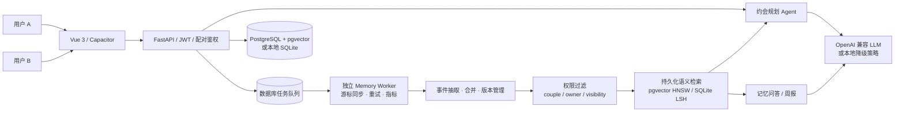

# 墨韵 LoveMemory · 真情侣 AI 助手

> 不是虚拟恋人，而是帮助真实情侣记住共同经历、管理双方偏好并规划约会的共享记忆 Agent。

   

本地 Demo：`http://localhost:5173` ｜ API 文档：`http://localhost:8000/docs`

## 1. 为什么做这个

传统情侣应用擅长保存照片、日记和纪念日，但这些数据通常只是被展示，无法继续帮助两个人：

- **记不住：** 重要经历、饮食禁忌和未来计划分散在聊天、日记和相册中；
- **不会复用：** 规划约会时仍需从零讨论，过去记录的双方偏好没有真正参与决策；
- **隐私边界模糊：** “情侣共享”不等于所有内容都应自动向另一方公开。

墨韵将现有聊天、日记、相册、纪念日作为真实数据入口，再通过 **权限过滤 → 事件粒度记忆 → 混合检索 → 有引用生成**，让 AI 基于两个人的真实记录工作。

> 个人独立开发的求职展示项目。仓库不包含真实用户数据、生产密钥或邮箱授权码。

## 2. 核心能力

| 功能 | 用户价值 | 实现方式 |
|---|---|---|
| 双人长期记忆 | 自动同步聊天、日记、相册、纪念日，也可主动记录偏好 | 统一记忆模型 + 事件级自动提取 + 来源追溯 |
| 共享/私密权限 | 共享记忆双方可见，私密记忆仅所有者可检索 | `couple_id + owner_id + visibility` 检索前过滤 |
| 智能约会规划 | 结合预算、日期、双方偏好与历史经历生成可执行方案 | 受控规划 Agent + RAG 来源引用 + 调用日志 |
| 每日互动与周报 | 双方回答后才解锁答案，并生成有依据的共同回顾 | 双人状态机 + Grounded Generation |

聊天、情侣相册、共同日记、纪念日、提醒、菜谱、AI 文案和旅游知识库等已有功能继续保留，作为完整情侣空间与 AI 数据来源。

## 3. 系统架构



一次约会规划请求的链路：

1. JWT 鉴权并确认当前 `couple_id`；
2. 根据 `shared` 或当前用户拥有的 `private` 记忆先做权限过滤；
3. 使用持久化 Embedding、关键词、状态、时间与重要度进行混合排序；
4. 将 Top-K 记忆、预算、日期和限制注入规划 Prompt；
5. 返回约会方案以及实际参与生成的记忆来源；
6. 保存方案与 AI 调用日志，便于追踪和复盘。

## 4. 核心难点与解决方案

### 双人记忆权限与偏好变化

每条记忆记录 `couple_id`、`owner_id`、`visibility`、`category`、`version` 和 `is_active`。检索前先做数据库级权限过滤，避免私密内容进入 Prompt。相同用户以相同标题更新偏好时，旧事实保留但停止参与检索，新事实版本号递增。

对应测试覆盖：用户 A 私密偏好对 A 可见、对 B 不可见；A 的规划可以使用该偏好，B 的规划来源中不能出现该偏好。

### 原始聊天噪声与可解释检索

聊天原文完整保留，长期记忆只保存事件、偏好、计划和事实。事实绑定主体、陈述者、时间与原始消息 ID；用户可查看依据、纠正或让 AI 忘记。检索使用持久化语义向量与关键词混合排序，私密权限在进入候选池前过滤。

### 独立任务队列与可观测性

每条新聊天只执行幂等入队，独立 Worker 使用数据库租约领取任务。进程崩溃后租约到期可自动重领，模型失败时游标保持不动并指数退避。管理端展示消息积压、失败率、P50/P95 耗时、模型调用、Token 与按配置单价估算的费用。

### 外部模型不可用时仍可演示

AI 服务采用 OpenAI 兼容接口，但未配置 Key 或接口失败时，会进入本地规则降级路径。降级回答仍严格使用已检索来源，保证项目可运行、可测试，也避免把网络可用性当作核心业务正确性的前提。

## 5. RAG 离线评测

评测集包含 20 条虚构情侣记忆和 20 个手工标注问题，指标由 [`backend/eval_memory_rag.py`](backend/eval_memory_rag.py) 实际运行得到：

| 检索方案 | Recall@3 | MRR | 本机平均延迟 |
|---|---:|---:|---:|
| 纯字符 TF-IDF（对照组） | 100%（20/20） | 1.0000 | 约 7 ms |
| TF-IDF + 关键词 + 时间/重要度混合排序 | 100%（20/20） | 1.0000 | 约 9 ms |

这是用于回归验证的小规模合成集，不代表生产效果。当前简单数据已经饱和，混合排序尚未体现准确率收益且存在少量额外耗时；下一步需要扩充困难负样本和冲突偏好，再加入 Embedding 与 Reranker 对照。

## 6. 技术选型

| 层 | 选型 | 原因 |
|---|---|---|
| Web 前端 | Vue 3 + Vite + Element Plus | 组件化开发快，同时可通过 Capacitor 打包 Android |
| API | FastAPI | 类型校验、依赖注入和 Swagger 文档适合 AI 接口快速迭代 |
| 数据 | PostgreSQL + pgvector / SQLite | Compose 使用 PostgreSQL；本地仍可零配置运行 SQLite |
| 检索 | Embedding + HNSW/LSH + 混合排序 | 大数据用 pgvector HNSW，小规模与离线测试使用持久化 LSH |
| 后台任务 | 数据库持久化队列 + 独立 Worker | 不依赖请求触发，支持租约、重试、积压与成本监控 |
| AI | OpenAI 兼容 API + 本地降级 | 可切换模型提供商，也能离线完成演示和自动化测试 |
| 实时能力 | WebSocket | 支持情侣聊天实时收发 |

当前没有使用 LangGraph、Celery 或 Redis。任务队列直接复用业务数据库，通过租约保证多 Worker 不重复处理，减少个人项目的额外运维服务。

## 7. 项目结构

```text
.
├── backend/
│   ├── app/models/          # 用户、配对、记忆、约会方案等模型
│   ├── app/routers/         # REST / WebSocket 接口
│   ├── app/services/        # AI、记忆检索、邮件和 RAG 服务
│   ├── tests/               # 权限、问答、规划端到端测试
│   ├── eval_memory_rag.py   # 可复现离线检索对照评测
│   └── seed_demo.py         # 幂等虚构演示数据
├── frontend/
│   └── src/views/ai/        # 共享记忆、约会规划等 AI 页面
├── docs/                    # 产品与技术设计
├── docker-compose.yml       # 容器化启动
├── start-app.bat            # Windows 一键启动
└── README.md
```

## 8. 快速开始

建议使用 Node.js 22（Capacitor 8 的 CLI 运行要求）和 Python 3.10。

```powershell
conda create -n couple-app python=3.10 -y
conda activate couple-app
pip install -r backend/requirements.txt
Copy-Item backend/.env.example backend/.env

cd frontend
npm ci
cd ..
.\start-app.bat
```

AI Key 可暂时留空；QQ 邮箱验证码需要填写 SMTP 邮箱和授权码。完整字段见 [`backend/.env.example`](backend/.env.example)。

### Docker Compose

```powershell
Copy-Item backend/.env.example backend/.env
# 按需填写 AI / SMTP 配置
docker compose up --build
```

Compose 会启动 PostgreSQL/pgvector、FastAPI、独立记忆 Worker 和 Nginx 前端，并使用命名卷持久化数据库与上传文件。

### 虚构演示账号

在本地后端环境中执行：

```powershell
cd backend
conda run -n couple-app python seed_demo.py
```

脚本可重复运行，不会删除其他账号或业务数据，也不会重复插入同一批记录。它会生成一套
覆盖 `2026-04-23` 至 `2026-10-23` 的六个月情侣使用时间线，包括约 485 条聊天、48 篇日记、
61 张相册演示图、10 个纪念日和 36 道带评分与留言的共同菜谱，并同步为可供 AI 检索的共同记忆。
随后在登录页选择“密码登录”：

- `demo.a@example.com` / `Demo123456!`
- `demo.b@example.com` / `Demo123456!`
- 配对码：`LOVE2026`

演示账号只能用于本地或隔离的演示环境，不应部署到公开生产数据库。

## 9. 测试

```powershell
cd backend
conda run -n couple-app python -m unittest discover -s tests -v
conda run -n couple-app python eval_memory_rag.py
conda run -n couple-app python eval_memory_e2e.py --smoke

# 匿名真实聊天：先生成本地标注模板，再评测 reviewed=true 的样本
conda run -n couple-app python eval_memory_anonymized.py --prepare-couple 1
conda run -n couple-app python eval_memory_anonymized.py --input data/private_evals/review_cases.jsonl

cd ..\frontend
npm run build
```

当前自动化测试覆盖隐私授权、多源同步、来源引用问答、双人答案解锁、AI 自动事件提取、共同周报、私密记忆隔离、偏好版本、后台任务队列和约会规划。

前端生产依赖执行 `npm audit --omit=dev` 的当前结果为 0 个已知漏洞；Capacitor CLI 属于开发依赖，其上游工具链仍可能报告 moderate 级审计项，不进入生产 Nginx 镜像。

## 10. 核心 API

| 方法 | 路径 | 说明 |
|---|---|---|
| `PUT` | `/api/ai/memory/settings` | 开启共同记忆并配置数据来源 |
| `POST` | `/api/ai/memory/manual` | 写入共享或私密事件/偏好 |
| `POST` | `/api/ai/memory/chat` | 基于当前用户可见记忆问答 |
| `POST` | `/api/ai/memory/extract` | 兼容入口：触发自动增量事件整理 |
| `POST` | `/api/ai/date-plan` | 生成有记忆依据的约会方案 |
| `GET` | `/api/ai/date-plan` | 查看当前用户创建的历史方案 |

## 11. Roadmap

- [x] 情侣配对与现有生活记录功能
- [x] 多来源共同记忆与自动事件提取
- [x] 共享/私密权限隔离和偏好版本
- [x] 有来源引用的记忆问答、周报和约会规划
- [x] 离线评测与端到端测试
- [ ] 扩充 100+ 困难问题并做检索消融实验
- [x] 接入持久化 Embedding 与 pgvector HNSW/SQLite LSH
- [x] 独立同步 Worker、失败退避与运行监控
- [x] 匿名真实聊天人工标注评测工具
- [ ] 地点检索、天气和日历工具（写入前需用户确认）
- [x] Docker Compose 本地容器化
- [ ] 线上演示环境
- [ ] 30 秒产品演示 GIF 和界面截图

## 12. 开源与隐私

- `.env`、数据库、上传文件、日志和构建产物均已加入 `.gitignore`；
- 演示与评测数据全部为虚构数据；
- 清空 AI 索引不会删除原始聊天、日记、照片或纪念日；
- 本项目采用 [MIT License](LICENSE)。
