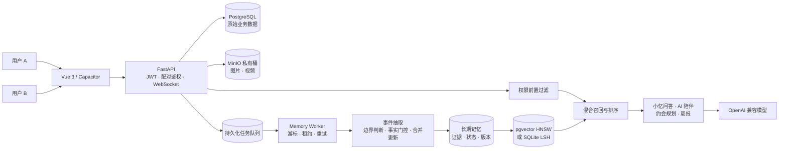

# 墨韵 Moyun

> 面向长期聊天的 AI 共同记忆与智能陪伴系统


墨韵是一款服务于真实情侣的全栈 AI 应用。它完整保留聊天、日记、相册和纪念日，再把碎片记录整理成可追溯的事件、偏好、计划与事实，让“小忆”能够在长期积累后找回相关经历、回答问题，并为约会规划和内容生成提供依据。

项目由个人独立完成需求分析、系统设计、前后端开发、模型接入、评测、容器化与部署配置。仓库不包含真实用户数据、生产密钥或邮箱授权码。

本地应用：`http://localhost:5173` · API 文档：`http://localhost:8000/docs` · MinIO 控制台：`http://localhost:9001`

## 项目亮点

- **事件粒度的长期记忆：** 原始聊天全量留存，AI 只把具有长期价值的内容整理为事件、偏好、计划和事实，过滤“嗯”“哈哈”等噪声。
- **不会漏历史的增量同步：** 独立 Memory Worker 按同步游标持续补齐新消息，使用数据库任务、租约、重试和退避机制，不依赖用户发起提问。
- **持久化语义检索：** PostgreSQL 使用 pgvector HNSW，本地 SQLite 使用持久化向量与 LSH；结合语义、关键词、时间、状态和重要度进行混合排序。
- **有依据的回答：** 记忆保留原始消息证据和来源；生日、纪念日、最早聊天等结构化问题优先查询确定性数据，缺少证据时明确表示无法确认。
- **检索前权限隔离：** 先根据 `couple_id + owner_id + visibility` 过滤候选，再进行召回和生成，避免私密内容进入另一方的 Prompt。
- **完整工程闭环：** WebSocket 实时聊天、MinIO 私有媒体存储、后台监控、自动化测试、端到端评测和 Docker Compose 均已落地。

## 为什么需要事件级记忆

聊天消息是交流载体，不等于长期记忆。一段旅行可能分散在几十条消息里，同一计划也可能经历提出、修改、取消和完成。如果直接把每条消息都放入向量库，噪声会淹没有价值的事实，模型也容易把旧计划当成当前状态。

墨韵采用分层设计：

| 数据层 | 保存内容 | 作用 |
|---|---|---|
| 原始记录 | 聊天、日记、相册、纪念日 | 完整留存与证据追溯 |
| 长期记忆 | 事件、偏好、计划、事实及其状态 | 跨时间检索与推理 |
| 向量索引 | 记忆 Embedding 和检索元数据 | 持久化语义召回 |

一条长期记忆不仅包含摘要，还保存主体、时间、类别、状态、可见范围、证据消息 ID 和版本。偏好变化或计划取消时，系统更新当前状态，同时保留历史版本以便追溯。

## 系统架构



### 长期记忆处理链路

1. 新消息写入业务数据库，并幂等创建同步任务。
2. Worker 从当前游标之后分批读取消息；任务失败时不推进游标。
3. 模型结合相邻消息识别事件边界，输出结构化候选记忆。
4. 事实完整性和长期价值门控过滤闲聊、即时状态和缺少证据的推断。
5. 新事件写入记忆库；同一事件的补充、取消或完成会合并并更新状态。
6. 记忆生成 Embedding 并持久化，原始消息 ID 始终保留用于追溯。
7. 问答时先过滤权限，再全量召回有资格的记忆，混合排序后取 Top-K 交给模型。

## 功能概览

### 情侣共同空间

- 情侣配对、双方资料与登录状态管理
- WebSocket 实时聊天、历史分页、未读数和聊天日期日历
- 共同日记、共享相册、图片与视频上传
- 纪念日、生日提醒和共同菜谱
- 通知设置与情侣主页

### AI 与长期记忆

- 聊天事件自动抽取、合并、状态更新和证据查看
- 日记、相册、纪念日和手动记录等多来源知识
- 共享/私密记忆、偏好版本和删除/纠正
- 小忆记忆问答、会话历史和主动提醒
- AI 情感陪伴、共同周报和日记总结
- 基于双方偏好、预算和历史经历的约会规划
- 个性文案、纪念日文案与旅游 RAG 知识库

### 工程与运维

- PostgreSQL/SQLite 双数据库模式
- pgvector HNSW/SQLite LSH 持久化语义索引
- 数据库任务队列与独立 Memory Worker
- MinIO/S3 兼容私有对象存储和短期签名 URL
- 任务积压、失败率、延迟、Token 和估算成本监控
- Docker Compose 一键启动

## 端到端评测

最新评测覆盖“原始碎片聊天 → AI 事件抽取 → 持久化 → 语义检索 → AI 最终回答 → 事实一致性复核”的完整链路。

**数据集：** 3000 条自然化碎片聊天、64 个带标准答案的事件、36 批纯闲聊、64 个正向问题和 24 个无答案问题。抽取模型为 `qwen3.8-max`，向量模型为 `text-embedding-v3`。

| 指标 | 结果 |
|---|---:|
| 事件抽取召回率 | 100.00% |
| 抽取记忆内容正确率 | 98.44% |
| 抽取精确率 / 纯闲聊拒绝率 | 100.00% / 100.00% |
| 日期 / 状态 / 类别正确率 | 100.00% / 100.00% / 100.00% |
| 单事件单记忆粒度正确率 | 100.00% |
| 端到端 Recall@5 | 100.00% |
| 最终答案正确率 | 100.00% |
| 无答案拒答率 / 最终未编造率 | 95.83% / 100.00% |
| 端到端中位耗时 | 1467.72 ms |

长期价值门控把首轮宽松抽取产生的 370 条记忆收敛为 64 条标准事件，并将 312 条缺少事件证据的多余记忆降至 0。

以上结果来自保持真实碎片结构的合成盲测数据，不包含用户隐私，也不等同于真实生产数据表现；模型或提示词变化后需要重新运行。完整方法、失败样例和适用边界见 [长期记忆端到端真实性测试报告](backend/reports/memory_e2e_report.md)。

完整功能验收还覆盖 16 个核心页面和 16 万级聊天记录下的分页、计数、日历与实时发送，详见 [完整功能验收报告](docs/完整功能验收报告-2026-11-04.md)。

## 技术栈

| 层级 | 技术 |
|---|---|
| Web / 移动端 | Vue 3、Vite、Pinia、Vue Router、Element Plus、Capacitor |
| API / 实时通信 | FastAPI、Pydantic、SQLAlchemy、JWT、WebSocket |
| 数据与检索 | PostgreSQL、pgvector、SQLite、Embedding、HNSW、LSH、混合排序 |
| AI | OpenAI 兼容 API、Qwen、结构化抽取、Grounded Generation |
| 媒体 | MinIO / S3 兼容对象存储、私有桶、Presigned URL |
| 工程 | Docker Compose、Nginx、数据库任务队列、自动化测试与评测 |

项目没有额外引入 Redis、Celery 或 LangGraph。后台任务直接复用业务数据库，通过幂等键和租约协调多个 Worker，降低个人项目的部署复杂度。

## 快速开始

### Docker Compose（推荐）

准备 Docker Desktop，然后在项目根目录执行：

```powershell
Copy-Item .env.example .env
Copy-Item backend/.env.example backend/.env

# 编辑 .env：更换数据库和 MinIO 密码
# 编辑 backend/.env：填写 AI_API_KEY；如需邮箱验证码，再填写 SMTP 配置

docker compose up -d --build
docker compose ps
```

Compose 会启动 PostgreSQL/pgvector、MinIO、FastAPI、Memory Worker 和 Nginx 前端。AI Key 留空时仍可启动并体验基础功能，但事件抽取、语义 Embedding 和生成式功能需要可用的模型接口。

| 服务 | 地址 |
|---|---|
| Web 应用 | `http://localhost:5173` |
| Swagger API | `http://localhost:8000/docs` |
| MinIO API | `http://localhost:9000` |
| MinIO 控制台 | `http://localhost:9001` |

MinIO 登录账号来自根目录 `.env` 的 `COUPLE_MINIO_ROOT_USER` 和 `COUPLE_MINIO_ROOT_PASSWORD`。数据库只保存稳定的 `s3://bucket/key` 引用，客户端访问图片和视频时由后端签发短期 URL。

### 本地开发

建议使用 Python 3.10 和 Node.js 22：

```powershell
python -m venv backend/.venv
backend/.venv/Scripts/python.exe -m pip install -r backend/requirements.txt
Copy-Item backend/.env.example backend/.env

cd frontend
npm ci
cd ..

.\start-app.bat
```

本地模式默认使用 SQLite 和本地文件目录；存储、模型、数据库、SMTP 与 Worker 配置见 [`backend/.env.example`](backend/.env.example)。

## 演示数据与账号

在隔离的本地环境中执行：

```powershell
cd backend
.\.venv\Scripts\python.exe seed_demo.py
```

脚本可重复执行，不会删除其他账号或重复插入同一批记录。随后在登录页选择“密码登录”：

- `demo.a@example.com` / `Demo123456!`
- `demo.b@example.com` / `Demo123456!`
- 配对码：`LOVE2026`

这些账号只用于本地演示，不应放入公开生产数据库。

## 测试与评测

```powershell
# 后端自动化测试
cd backend
.\.venv\Scripts\python.exe -m unittest discover -s tests -v

# 小规模端到端记忆冒烟测试
.\.venv\Scripts\python.exe eval_memory_e2e.py --smoke

# 检索真实性评测
.\.venv\Scripts\python.exe eval_memory_realism.py

# 前端生产构建
cd ..\frontend
npm run build
```

当前后端自动化测试为 **59/59 通过**，覆盖认证、权限隔离、多来源同步、事件抽取、证据引用、偏好版本、任务队列、对象存储、约会规划和结构化记忆问答。完整端到端评测会调用模型并产生费用，建议先使用 `--smoke`，确认配置后再运行完整数据集。

## 项目结构

```text
.
├── backend/
│   ├── app/
│   │   ├── models/          # 用户、配对、消息、记忆、任务等数据模型
│   │   ├── routers/         # REST API 与 WebSocket
│   │   ├── services/        # AI、记忆检索、对象存储与业务服务
│   │   └── memory_worker.py # 独立记忆工作进程
│   ├── tests/               # 后端自动化测试
│   ├── reports/             # 可复现评测报告
│   ├── eval_memory_e2e.py   # 端到端记忆评测
│   └── seed_demo.py         # 幂等演示数据
├── frontend/
│   └── src/                 # Vue 页面、组件、状态与 API 封装
├── docs/                    # 设计与验收文档
├── docker-compose.yml       # 完整服务编排
├── start-app.bat            # Windows 本地启动入口
└── README.md
```

## 关键 API

| 方法 | 路径 | 说明 |
|---|---|---|
| `POST` | `/api/auth/login` | 账号登录 |
| `GET` | `/api/chat/history` | 分页读取聊天记录 |
| `WS` | `/ws/chat` | 实时聊天 |
| `POST` | `/api/album` | 上传图片或视频 |
| `PUT` | `/api/ai/memory/settings` | 配置长期记忆数据来源 |
| `POST` | `/api/ai/memory/manual` | 新增共享或私密记忆 |
| `POST` | `/api/ai/memory/chat` | 基于可见记忆问答 |
| `POST` | `/api/ai/companion/chat` | 小忆陪伴对话 |
| `POST` | `/api/ai/date-plan` | 生成有记忆依据的约会方案 |
| `POST` | `/api/rag/chat` | 查询用户知识库 |

具体请求结构以运行后的 Swagger 文档为准。

## 数据与隐私边界

- `.env`、数据库、上传文件、日志和构建产物均已加入 `.gitignore`。
- 相册与聊天媒体存入私有对象桶，读取链接短期有效。
- 共享记忆对双方可见；私密记忆只允许所有者检索。
- 清空 AI 记忆索引不会删除原始聊天、日记、相册或纪念日。
- 演示和公开评测数据均为虚构数据，不包含真实用户隐私。
- 正式上线仍需更换所有默认密码、关闭本地验证码并配置 HTTPS、备份与监控。

## Roadmap

- [x] 多来源事件级长期记忆与证据追溯
- [x] 持久化 Embedding 与混合语义检索
- [x] 独立 Worker、游标同步、租约重试和运行监控
- [x] 私密/共享权限隔离和偏好状态版本
- [x] MinIO 图片与视频存储
- [x] 端到端抽取、检索、回答与防编造评测
- [ ] 使用匿名真实聊天样本进行人工复核
- [ ] 对接天气、地图和日历工具
- [ ] 前端路由拆包与首屏性能优化
- [ ] 微信小程序适配与线上演示环境

## License

本项目采用 [MIT License](LICENSE)。
