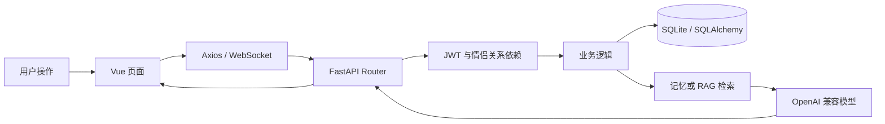
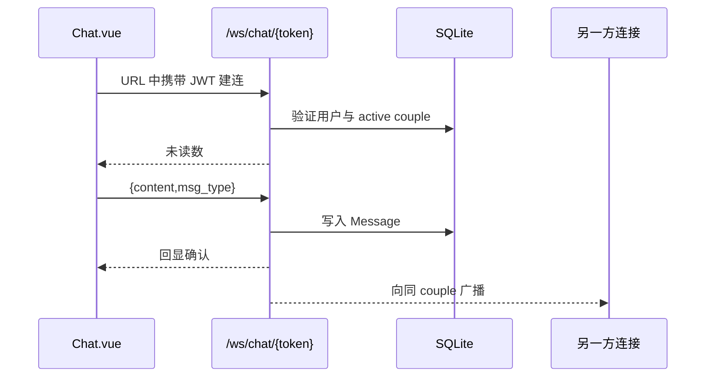

# 墨韵 LoveMemory 项目开发者学习手册

> 本文以当前仓库代码为准，不以产品设想为准。目标是让你从“会运行项目”逐步达到“能定位问题、修改功能、补测试并完成部署”。
>
> 代码基线：`2e8b7cd Initial import: Moyun AI couple memory assistant`；核对日期：2026-10-26。

## 1. 先建立正确的项目心智模型

这是一个面向真实情侣的共享空间，不是虚拟恋人应用。基础能力包括认证、情侣配对、实时聊天、纪念日、相册、日记和菜谱；AI 能力建立在这些真实业务数据之上，包括陪伴对话、共同记忆、记忆问答、每日互动、周报、约会规划、文案生成、日记总结和旅游文档问答。

最重要的三个设计边界是：

1. **情侣空间隔离**：大部分共享业务表都带 `couple_id`，后端查询必须同时限制当前情侣关系。
2. **个人隐私隔离**：共同记忆除 `couple_id` 外，还用 `owner_id + visibility` 区分共享记忆和本人私密记忆。
3. **AI 不是事实源**：原始聊天、日记、相册和纪念日才是事实源；AI 只做抽取、检索和生成，并应保留来源或可追踪日志。

可以把整个系统理解为下面这条链路：



## 2. 技术栈与实际版本

| 层 | 技术 | 当前用途 |
|---|---|---|
| Web 前端 | Vue 3.4、Composition API | 页面与交互 |
| UI | Element Plus 2.6 | 表单、弹窗、表格、提示等 |
| 状态与路由 | Pinia 2、Vue Router 4 | 登录态、用户态、权限导航 |
| HTTP | Axios 1.6 | REST API、统一 token 与错误处理 |
| 构建 | Vite 5 | 本地开发、代理、生产打包 |
| Android | Capacitor 8 | 将前端构建产物装入 Android WebView |
| API | FastAPI 0.110、Uvicorn | REST API 与 WebSocket |
| ORM | SQLAlchemy 2.0 | 模型和数据库访问 |
| 数据库 | SQLite | 当前唯一真正启用的数据库 |
| 认证 | JWT、passlib/bcrypt | 7 天登录令牌、密码哈希 |
| AI | OpenAI Python SDK | 调用兼容 Chat Completions 的模型服务 |
| 检索 | scikit-learn TF-IDF、NumPy | 共同记忆和旅游文档检索 |
| 邮件 | QQ SMTP | 邮箱验证码 |
| 部署 | Docker Compose、Nginx | 前后端容器化运行 |

重要事实：配置文件虽然声明了 `DATABASE_URL`，但数据库引擎实际固定使用 `settings.sqlite_url`，因此当前并没有真正支持通过环境变量切换 MySQL 或 PostgreSQL。

## 3. 仓库结构与职责

```text
couple-app-ai-master/
├── backend/
│   ├── app/
│   │   ├── main.py              # FastAPI 创建、CORS、静态目录、路由注册
│   │   ├── config.py            # 环境变量与 data/uploads 路径
│   │   ├── database.py          # SQLite engine、Session、建表和轻量迁移
│   │   ├── deps.py              # 当前用户、有效情侣、管理员依赖
│   │   ├── models/__init__.py   # 全部 SQLAlchemy 表模型
│   │   ├── schemas/__init__.py  # 全部 Pydantic 输入输出模型
│   │   ├── routers/             # 按业务拆分的 API 层
│   │   ├── services/            # AI、记忆检索、RAG、邮件服务
│   │   └── utils/__init__.py    # 密码与 JWT
│   ├── tests/                   # 后端自动化测试
│   ├── eval_memory_rag.py       # 共同记忆检索离线评测
│   ├── seed_demo.py             # 幂等演示数据生成
│   ├── run.py                   # Uvicorn 启动入口
│   └── requirements.txt
├── frontend/
│   ├── src/
│   │   ├── api/index.js         # Axios 实例和全部前端 API 封装
│   │   ├── router/index.js      # 页面路由和导航守卫
│   │   ├── stores/user.js       # token、当前用户、登录状态
│   │   ├── views/               # 页面组件
│   │   ├── components/          # 全局悬浮情侣助手
│   │   ├── utils/image.js       # 上传前图片压缩与格式转换
│   │   └── styles/global.css    # 全局设计变量与通用样式
│   ├── android/                 # Capacitor 生成的 Android 工程
│   ├── vite.config.js           # 本地代理与开发服务器
│   └── package.json
├── docs/                        # 设计、技术和本学习手册
├── docker-compose.yml
├── start-app.bat                # Windows 一键启动
└── 打包指南-Android-APK.md
```

阅读代码时，建议先看 `main.py → models → deps → 某个 router → 对应前端 api → 对应 view`，不要一开始钻进大段 CSS。

## 4. 本地运行

### 4.1 首次准备

建议使用 Python 3.10 和 Node.js 22：

```powershell
conda create -n couple-app python=3.10 -y
conda activate couple-app
python -m pip install -r backend/requirements.txt
Copy-Item backend/.env.example backend/.env

Set-Location frontend
npm ci
Set-Location ..
```

`.env` 中的 AI Key 和 SMTP 可以先留空。没有 SMTP 时，验证码会直接出现在 `/api/auth/send-code` 的响应中；没有 AI Key 时，AI 服务走本地规则模板，因此核心演示和测试仍能运行。

### 4.2 启动方式

Windows 一键启动：

```powershell
.\start-app.bat
```

也可以分别启动：

```powershell
Set-Location backend
conda run -n couple-app --no-capture-output python run.py

# 新终端
Set-Location frontend
npm run dev
```

访问地址：

- Web：`http://localhost:5173`
- API 根路径：`http://localhost:8000`
- Swagger：`http://localhost:8000/docs`
- 健康检查：`http://localhost:8000/health`

Vite 会把 `/api`、`/uploads` 和 `/ws` 代理到 `localhost:8000`。所以浏览器开发环境中的 `VITE_API_BASE` 通常留空；APK 或前后端分离部署时则必须写成客户端能够访问的后端地址。

### 4.3 演示数据

```powershell
Set-Location backend
conda run -n couple-app python seed_demo.py
```

它会创建一对虚构情侣、半年聊天/日记/相册/纪念日/菜谱数据，并同步共同记忆。脚本按业务唯一条件做幂等插入，不会清空其他用户数据。

- `demo.a@example.com / Demo123456!`
- `demo.b@example.com / Demo123456!`
- 配对码 `LOVE2026`

## 5. 一次普通请求如何走完

以“新增日记”为例：

1. `Diary.vue` 收集标题、正文和心情。
2. 页面调用 `diaryApi.create(data)`。
3. Axios 请求拦截器从 `localStorage` 读取 token，加入 `Authorization: Bearer ...`。
4. FastAPI 命中 `POST /api/diaries`。
5. `get_current_user` 解 JWT 并查询用户；`get_active_couple` 验证用户已绑定且情侣关系为 `active`。
6. Router 创建 `Diary(couple_id=当前情侣, author_id=当前用户, ...)`。
7. SQLAlchemy `commit + refresh` 后返回序列化结果。
8. 页面刷新列表。
9. 如果共同记忆已开启，下次同步时该日记会被 upsert 为一条 `SharedMemory`。

新增业务时，应尽量保持同样的分层：页面只管交互，`api/index.js` 管请求，Schema 管输入边界，Router 管权限和编排，Service 管可复用业务规则，Model 管持久化。

## 6. 后端入口、配置与依赖注入

### 6.1 应用入口

`backend/app/main.py` 做四件事：

- 创建 FastAPI 应用；
- 设置 CORS；
- 把 `backend/data/uploads` 挂载为 `/uploads`；
- 注册全部 REST Router 和 `/ws/chat/{token}` WebSocket；
- 启动时调用 `init_db()`。

### 6.2 数据库生命周期

`database.py` 创建全局 engine 和 `SessionLocal`。普通 REST 请求通过 `get_db()` 获取 session，并在请求结束时关闭。WebSocket 和检索服务因不走普通依赖注入，会直接创建 `SessionLocal()` 并在 `finally` 中关闭。

`init_db()` 先运行 `Base.metadata.create_all()`，然后只对少数字段执行手写 `ALTER TABLE`。这不是完整迁移系统：它能兼容当前几个历史字段，但不能安全承担复杂表结构演进。后续应引入 Alembic。

### 6.3 三个权限依赖

| 依赖 | 保证 |
|---|---|
| `get_current_user` | token 有效，且用户仍存在 |
| `get_active_couple` | 用户有 `couple_id`，对应关系存在且为 `active` |
| `require_admin` | 当前用户 `is_admin=True` |

安全审查时最先看路由是否使用了正确依赖，再看数据库查询是否带 `couple_id`。只验证登录而不验证数据归属，是此类应用最危险的越权来源。

## 7. 数据模型

当前共有 19 个表模型，可按五组理解。

### 7.1 身份与情侣关系

| 表 | 关键字段 | 说明 |
|---|---|---|
| `users` | `email`, `password_hash`, `couple_id`, `is_admin` | 用户；`phone` 是旧字段，当前认证使用邮箱 |
| `couples` | `user1_id`, `user2_id`, `status`, `pairing_code` | 两人关系和共享界面配置 |
| `verification_codes` | `email`, `code`, `purpose`, `expires_at`, `used` | 注册/登录与重置密码验证码 |

`Couple.status` 的状态是 `pending → active → dissolved`。用户表保存 `couple_id`，情侣表又保存双方 ID，这种双向冗余方便查询，但修改关系时必须保持一致。

### 7.2 日常业务

| 表 | 归属与作用 |
|---|---|
| `messages` | 按 `couple_id` 隔离的文字/图片消息 |
| `anniversaries` | 纪念日与提醒开关 |
| `photos` | 相册元数据，真实文件在 `data/uploads/photos` |
| `diaries` | 共同日记，记录作者和心情 |
| `reminders` | 当前主要由创建纪念日时写入 |
| `recipes` | 菜谱主体，食材和步骤用 JSON 字符串保存 |
| `recipe_ratings` | 用户对菜谱的评分 |
| `recipe_comments` | 菜谱留言 |

### 7.3 AI 会话和日志

| 表 | 作用 |
|---|---|
| `ai_conversations` | 按用户保存不同类型会话 |
| `ai_messages` | 会话消息及 JSON 来源信息 |
| `ai_call_logs` | 功能、输入、输出、状态，供管理后台追踪 |

### 7.4 旅游文档 RAG

| 表 | 作用 |
|---|---|
| `documents` | 原始文档正文与切片数 |
| `document_chunks` | 500 字左右的切片、所属情侣、序号和向量字节串 |

### 7.5 共同记忆和约会规划

| 表 | 作用 |
|---|---|
| `couple_ai_settings` | 情侣级 opt-in 和四类数据源开关 |
| `shared_memories` | 统一事件/偏好/计划，支持审核、隐私和版本 |
| `date_plans` | 当前用户生成的约会方案及使用过的来源 |
| `daily_questions` | 每对情侣每天唯一的问题 |
| `daily_answers` | 每位用户每题唯一的回答 |

`SharedMemory` 是整个 AI 部分的核心。关键字段含义：

- `source_type/source_id`：原始来源；与 `couple_id` 组成唯一约束，保证同步幂等。
- `status`：`pending/confirmed/rejected`，AI 抽取默认待确认。
- `visibility`：`shared/private`。
- `owner_id`：私密记忆所有者。
- `category`：`event/preference/plan`。
- `version/is_active`：偏好变化时保留旧版本但只检索新版本。
- `importance`：混合排序的一项弱权重信号。

## 8. 认证与情侣配对

### 8.1 注册、登录、重置密码

认证路由位于 `/api/auth`：

- `POST /send-code`：生成 6 位码，有效期 5 分钟；SMTP 未配置时响应直接返回测试码。
- `POST /register`：验证 `general` 验证码，bcrypt 哈希密码，签发 JWT。
- `POST /login`：邮箱密码登录。
- `POST /login-code`：邮箱验证码登录。
- `POST /reset-password`：只接受 `reset_password` 用途的验证码，并使同类未用验证码全部失效。
- `GET /me`：恢复当前用户状态。
- `PUT /profile`、`POST /avatar`：修改昵称/头像。

邮箱在 Schema 中统一 `strip + lower`，查询时还兼容旧数据中的大小写和首尾空格。JWT 的 `sub` 是用户 ID，有效期 7 天；退出登录是前端删除 token，后端不维护令牌黑名单。

### 8.2 配对流程

1. 用户 A 调 `/couple/generate`，创建 `pending` Couple，并立即把 A 的 `couple_id` 指过去。
2. 用户 B 调 `/couple/bind` 输入配对码。
3. 后端写 `user2_id`、把状态改为 `active`，并设置 B 的 `couple_id`。
4. 之后需要情侣数据的接口统一经过 `get_active_couple`。

解除关系只把 Couple 改成 `dissolved`，业务数据仍保留。

## 9. 实时聊天

聊天同时使用 REST 与 WebSocket：



REST 端点负责：

- `/api/chat/history`：倒序查询后再反转，返回时间顺序；支持 `before` 游标和 `offset`。
- `/api/chat/count`：消息总数。
- `/api/chat/upload`：上传图片、直接落消息并广播。
- `/api/chat/unread-count`：统计对方发来的未读消息。
- `/api/chat/read/{id}`：标为已读。

数据库保存的是无时区 UTC 时间，输出时 `_message_timestamp()` 显式附加 `+00:00`。前端再按设备本地时区展示。测试覆盖了北京时间日期边界和向前分页。

连接管理器目前是进程内字典，因此只适合单进程部署；多 Uvicorn worker 或多实例时，需要 Redis Pub/Sub、专门的 WebSocket 网关或其他共享消息总线。

## 10. 普通共享功能

| 功能 | 后端前缀 | 页面 | 要点 |
|---|---|---|---|
| 纪念日 | `/api/anniversaries` | `Anniversary.vue` | CRUD、循环计算下一次日期、创建 Reminder |
| 相册 | `/api/album` | `Album.vue` | 文件保存到 photos 目录，数据库存 URL |
| 日记 | `/api/diaries` | `Diary.vue` | CRUD、作者与心情 |
| 菜谱 | `/api/recipes` | `RecipeList/Detail.vue` | 筛选、随机推荐、评分、留言、想吃、烹饪次数 |
| 设置 | `/api/settings`、`/api/couple` | `Settings.vue`、`Home.vue` | 通知、恋爱日期、首页背景、聊天背景 |
| 提醒 | `/api/ai/reminders` | `Reminders.vue` | 数据库提醒 + 30 天内动态纪念日提醒 |

这些功能都是“情侣共享空间”：只要属于同一个 active couple，双方一般都可查看、编辑或删除。当前并未对“只有作者可修改日记/照片/菜谱”做额外限制，这是产品规则而不是遗漏权限时需要先确认的地方。

## 11. AI 服务层

`AIService` 是所有生成能力的统一入口。初始化时读取 `AI_API_KEY / AI_API_BASE / AI_MODEL`，构造 OpenAI 兼容客户端。真正调用集中在 `chat()`；异常会记录日志并回退到本地模板，不会让页面直接崩溃。

它提供七类上层能力：

- `companion_chat`：情侣助手，附带当前用户可见的共同记忆。
- `generate_content`：纪念日、约会、关键词文案。
- `diary_summary`：日记总结。
- `rag_answer`：基于旅游文档上下文回答。
- `extract_memory`：把原始内容抽成结构化记忆 JSON。
- `memory_answer`：只依据共同记忆回答。
- `memory_report`、`date_plan`：周报与约会方案。

本地降级不是“真正的离线大模型”，而是可预测的规则和固定模板。它的价值是让无密钥环境可以演示、开发和测试；不能把降级输出当成模型质量结果。

## 12. 共同记忆：项目的核心业务

### 12.1 用户授权

共同记忆默认关闭。`CoupleAISettings` 控制总开关，以及聊天、日记、相册和纪念日四类来源。开启设置时会立即同步一次。

### 12.2 多源同步

`MemoryService.sync_sources()` 执行：

- 日记 → 内容、心情，重要度 `0.7`；
- 最近 500 条、长度至少 4 字的文字聊天 → 重要度 `0.35`；
- 纪念日 → 重要度 `0.95`；
- 相册 → 文件名描述，重要度 `0.55`。

同步使用 `(couple_id, source_type, source_id)` upsert，所以重复同步不会重复创建。注意：它会更新或新增来源，却不会自动删除“原始记录已经被删掉”的旧记忆，这是后续应补的同步一致性能力。

### 12.3 AI 抽取与人工确认

`POST /api/ai/memory/extract` 会：

1. 先同步来源；
2. 取最近的已确认聊天/日记；
3. 让 AI 提取标题、摘要、日期、地点、情绪、标签和重要度；
4. 写成 `source_type=ai_extract, status=pending`；
5. 用户在页面确认或拒绝。

因此“原始同步记录”默认是 confirmed，而“二次 AI 抽取记录”默认 pending。不要混淆这两层。

### 12.4 手动记忆与偏好版本

用户可以创建 `event/preference/plan`，并选择 `shared/private`。当同一用户用相同标题再次写入 `preference` 时：

- 旧偏好 `is_active=False`；
- 新偏好 `version + 1`；
- 旧事实保留用于审计，但不再参与默认列表和检索。

### 12.5 权限过滤

当前用户能看到的条件为：

```text
couple_id == 当前情侣
AND status == confirmed（检索时）
AND is_active == true
AND (visibility == shared OR visibility IS NULL OR owner_id == 当前用户)
```

这道过滤必须发生在构建 Prompt 之前。如果先检索全部再在输出阶段过滤，私密内容已经泄露给模型，仍然属于隐私漏洞。

### 12.6 混合检索

候选上限 1500 条。每次查询把 `title + content + location + tags` 组成文本，用中文友好的字符级 TF-IDF（1～3 gram）计算余弦相似度，再混合精确关键词、时间和重要度：

```text
score = TF-IDF相似度 × 0.72
      + 关键词命中率 × 0.23
      + 十年线性衰减的新近度奖励（最高约 0.05）
      + importance × 0.03
```

只返回 `score > 0.015` 的 Top-K。这个方案无需向量数据库，适合当前数据规模；代价是每次查询重新拟合 TF-IDF，数据增大后延迟和并发能力会变差。

### 12.7 记忆问答、周报和约会规划

- 记忆问答：先同步，再检索本人可见 Top-5，最近 8 条会话消息作为历史；响应只给答案和 `grounded`，不把原始来源暴露到聊天 UI。
- 周报：读取指定天数内的本人可见 confirmed 记忆，最多 300 条。
- 约会规划：把地点、预算、时长、本次偏好和禁忌与 Top-8 记忆一起生成；方案保存来源。
- 方案历史：因为方案可能用到创建者私密记忆，只允许创建者本人查看。
- 每日问题：双方各自回答前看不到对方答案；两名不同用户都回答后才一起解锁。

## 13. 旅游文档 RAG 与共同记忆的区别

项目里有两套检索，不要把它们当成一个模块：

| 对比 | 旅游文档 RAG | 共同记忆 |
|---|---|---|
| 数据入口 | 用户上传/粘贴文档 | 聊天、日记、相册、纪念日、手动记录 |
| 核心表 | `documents/document_chunks` | `shared_memories` |
| 切片 | 约 500 字、100 字重叠 | 一条业务记录就是一条记忆 |
| 检索 | 字符 TF-IDF 余弦相似度 | TF-IDF + 关键词 + 时间 + 重要度 |
| 权限 | `couple_id` | `couple_id + owner_id + visibility` |
| 来源展示 | 返回文档名和切片 | 记忆问答 UI 不展示原文，规划保存来源 |

旅游 RAG 的向量器和索引保存在 Python 进程内，数据库中的 `vector_b64` 当前没有在检索时复用。服务重启会从数据库重建；新增文档会重新拟合词表。多进程部署同样会产生各进程缓存不一致问题。

## 14. 前端架构

### 14.1 启动与状态

`main.js` 注册 Pinia、Router、Element Plus 和全部图标。`App.vue` 启动时若本地已有 token，就调用 `/auth/me` 恢复用户。

`stores/user.js` 只保存三个核心状态：

- `token`：同时持久化到 `localStorage`；
- `user`：当前用户；
- `assistantGreetingPending`：控制小助手首次问候。

### 14.2 路由守卫

路由元信息有三种：

- `requiresAuth`：必须登录；
- `guest`：已登录时不再进入登录/注册；
- `requiresCouple`：需要 `user.couple_id`；
- `requiresAdmin`：需要 `user.is_admin`。

注意：前端守卫只是体验优化，真正安全边界必须在后端。用户可以绕过前端直接发请求。

### 14.3 API 封装

`src/api/index.js` 是前后端契约的唯一前端入口：

- 统一 `/api` baseURL 和 30 秒超时；
- 自动附加 Bearer token；
- APK/ngrok 场景附加跳过提示页的 header；
- 统一抽取 FastAPI 错误；
- 401 时清 token 并跳转登录；
- `assetUrl()` 把 `/uploads/...` 变成 APK 可访问的绝对 URL。

开发新接口时，先在这里增加语义清晰的方法，再让页面调用。不要让多个页面各自拼 URL。

### 14.4 页面地图

| 导航区域 | 页面 |
|---|---|
| 首页 | 情侣封面、相恋天数、共同记忆摘要、下一提醒 |
| 生活 | 纪念日、相册、日记、菜谱 |
| 聊天 | WebSocket 实时聊天、图片、历史分页、日期跳转 |
| AI | 共同记忆、约会规划、提醒、关系回顾、文案、旅游 RAG |
| 我的 | 头像、昵称、通知、聊天背景、解除关系、退出 |
| 全局组件 | 可拖动的 `CoupleAssistantWidget`，在非后台情侣页面常驻 |
| 管理后台 | 统计、用户、情侣关系、AI 调用日志 |

### 14.5 图片与移动端

前端在上传大图时使用 Canvas 等比压缩，默认最长边 1920、JPEG 质量 0.85；小型常见格式直接上传。HEIC 若浏览器不能解码，会原样交给后端，但后端本身并没有真正的 HEIC 转码，所以这只是有限降级。

Capacitor 的 `webDir` 是 `dist`。典型 Android 更新流程：

```powershell
Set-Location frontend
npm run build
npx cap sync android
npx cap open android
```

完整签名和 APK/AAB 流程参见仓库根目录的《打包指南-Android-APK.md》。

## 15. API 速查

| 前缀 | 主要职责 |
|---|---|
| `/api/auth` | 验证码、注册、登录、个人资料、配对、解除关系 |
| `/api/chat` | 历史、数量、已读、图片、未读数 |
| `/ws/chat/{token}` | 实时聊天 |
| `/api/anniversaries` | 纪念日 CRUD |
| `/api/album` | 相册列表、上传、删除 |
| `/api/diaries` | 日记 CRUD |
| `/api/recipes` | 菜谱 CRUD、筛选、评分、留言、烹饪、想吃 |
| `/api/ai/companion` | AI 陪伴对话与历史 |
| `/api/ai/generate` | 文案生成 |
| `/api/ai/summary` | 日记总结与历史 |
| `/api/rag` | 旅游文档、问答、历史 |
| `/api/ai/memory` | 设置、同步、列表、手动记忆、抽取、审核、问答、报告、每日问题 |
| `/api/ai/date-plan` | 约会方案生成与本人历史 |
| `/api/ai/reminders` | 智能提醒列表 |
| `/api/couple`、`/api/settings` | 情侣信息、日期、背景和通知 |
| `/api/admin` | 统计、用户、情侣和 AI 日志 |

参数和响应的最终权威来源是运行中的 Swagger，以及 `schemas/__init__.py` 和对应 Router。

## 16. 测试、评测与当前验证结果

### 16.1 后端测试

```powershell
Set-Location backend
conda run -n couple-app python -m unittest discover -s tests -v
```

2026-10-26 实际结果：**11 个测试全部通过，约 4.04 秒**。覆盖：

- UTC 输出、北京时间边界和聊天向前分页；
- 注册、邮箱标准化、密码登录、验证码登录、密码重置；
- 恋爱开始日期共享、未来日期拒绝、未配对访问拒绝；
- 共同记忆 opt-in、多源同步、grounded 问答；
- 双方回答后解锁每日问题；
- AI 抽取待审核；
- 周报使用 confirmed 记录；
- 私密记忆隔离、偏好版本；
- 约会方案只使用当前用户可见记忆，历史只对创建者可见。

### 16.2 RAG 离线评测

```powershell
$env:PYTHONIOENCODING='utf-8'
conda run --no-capture-output -n couple-app python eval_memory_rag.py
```

2026-10-26 本机结果：

| 方案 | Recall@3 | MRR | 平均延迟 |
|---|---:|---:|---:|
| 纯字符 TF-IDF | 100% | 1.0000 | 4.93 ms |
| 混合排序 | 100% | 1.0000 | 7.61 ms |

数据集只有 20 条人工构造问题，属于回归测试，不足以证明生产检索质量。混合排序在当前简单数据上没有精度优势，只增加约 2.7 ms；下一步应加入相似负样本、冲突偏好、过期计划和隐私边界用例。

### 16.3 前端构建

```powershell
Set-Location frontend
npm run build
```

2026-10-26 实际构建成功。Rollup 提示入口 JS 约 1.25 MB、gzip 约 406 KB，超过 500 KB 警告线。页面已用动态 import，但 Element Plus 等公共依赖仍进入大块；这不阻塞运行，后续可用 `manualChunks` 或按需组件导入优化。

## 17. 如何新增一个完整功能

假设要新增“共同愿望清单”，推荐按下面顺序做：

1. **先写规则**：谁能创建、谁能编辑、是否私密、删除是否保留历史。
2. **建 Model**：在 `models/__init__.py` 增加 `Wish`，至少包含 `couple_id`、创建者、状态和时间。
3. **做迁移**：短期可由 `create_all` 建新表；正式演进应添加 Alembic migration。
4. **建 Schema**：创建、更新和输出分开，写长度、枚举、日期等校验。
5. **写 Router/Service**：注入 `get_current_user + get_active_couple`，所有查询带 `couple_id`。
6. **注册 Router**：在 `main.py` 导入并 `include_router`。
7. **封装前端 API**：在 `src/api/index.js` 添加 `wishApi`。
8. **建页面和路由**：Vue 页面只保存展示状态和交互状态。
9. **补测试**：至少测试正常流程、未登录、未配对、另一对情侣越权、无效输入。
10. **运行回归**：后端 11 项测试、相关新增测试、前端 build。
11. **若接入记忆**：明确 source type、同步幂等键、删除一致性和 privacy 语义。

一个可靠的完成标准不是“页面能点”，而是：数据归属正确、异常有明确响应、刷新后状态不丢、另一对情侣无法访问、测试可重复通过。

## 18. 常见排错路径

### 18.1 页面 401

检查浏览器请求是否带 `Authorization`，token 是否过期，`.env` 的 `SECRET_KEY` 是否在服务重启或多实例间一致。401 响应会触发前端清 token。

### 18.2 页面 403“尚未绑定”

查看 `/api/auth/me` 的 `couple_id`，再看 `couples.status` 是否为 `active`。前端仅依据 `couple_id` 判断 hasCouple，后端则要求 active，二者目前可能出现短暂不一致。

### 18.3 上传成功但图片不显示

浏览器先检查 `/uploads/...` 是否能直接访问；APK 再检查构建时的 `VITE_API_BASE`。数据库存的是相对路径，必须经过 `assetUrl()`。

### 18.4 WebSocket 连不上

检查 REST 后端是否启动、token 是否有效、情侣关系是否 active、开发代理是否包含 `/ws`。HTTPS 页面必须使用 `wss://`。APK 要确保后端地址对手机可达，`localhost` 指手机自身而不是电脑。

### 18.5 AI 总是模板回答

检查 `backend/.env` 的 `AI_API_KEY`、`AI_API_BASE` 和 `AI_MODEL`，然后重启后端。`AIService` 在模块导入时创建客户端，只修改 `.env` 而不重启不会更新。

### 18.6 共同记忆搜不到

依次检查：设置是否 enabled、来源开关、是否已 sync、记录是否 confirmed、是否 active、当前用户是否有 visibility 权限、检索分数是否高于 0.015。

### 18.7 修改模型后数据库没变化

`create_all()` 不会修改已有列。检查 `init_db()` 是否有对应轻量迁移；更推荐开始使用 Alembic，不要继续堆手写 `ALTER TABLE`。

## 19. 当前代码中需要优先知道的问题

这些不是本次修改，而是阅读当前代码后得到的维护清单。

### P0：公开部署前必须处理

1. 默认 `SECRET_KEY=change-me`，生产必须强随机并稳定保存。
2. CORS 当前为 `allow_origins=["*"]` 且允许 credentials，应改为明确前端域名。
3. 验证码接口没有发送频控、尝试次数限制或 IP/账号限流，存在滥发和暴力猜测风险。
4. WebSocket 把 JWT 放在 URL 路径，可能进入访问日志；生产应改成更安全的握手认证方式，并确保 TLS。
5. 上传文件主要依赖扩展名，部分接口没有大小/类型校验；静态上传目录也没有访问鉴权。
6. 共同记忆、日志和 AI 请求可能包含敏感关系数据，生产需要脱敏日志、数据保留策略和删除机制。

### P1：功能正确性与可维护性

1. `DATABASE_URL` 没有被 engine 使用，文档中的“可切换数据库”目前不成立。
2. `.env` 仍叫 `ADMIN_PHONE`，认证已改邮箱，且代码没有自动把任何账号设为管理员；后台需要手工改数据库才能进入。
3. 配对发起者一生成 pending 关系就已有 `couple_id`，前端“刷新状态”只看 `hasCouple`，可能在对方绑定前误报成功；应同时查询 Couple 状态。
4. 管理后台用户页和接口仍展示 `phone`，但当前注册只填 `email`，所以列表的手机号列通常为空。
5. 更新/删除纪念日时没有同步维护对应 `Reminder`；列表还会把数据库 Reminder 和动态纪念日提醒同时加入，可能重复。
6. 删除日记、聊天、相册或纪念日不会删除/停用已经同步的 SharedMemory，可能出现“原数据已删但 AI 仍记得”。
7. 数据库迁移是局部手写逻辑，需要尽快引入 Alembic。
8. 多个上传入口的校验规则不一致；相册和聊天图片没有 50 MB 限制。
9. 聊天 `_msg_out()` 在发送者昵称和 phone 都为空时对 `None` 切片，存在异常风险。

### P2：性能与工程质量

1. REST Router 中有多处 N+1 查询，例如相册、日记、菜谱输出逐条查询用户/评分/留言。
2. 共同记忆每次查询重新拟合 TF-IDF；旅游 RAG 使用进程内索引，均不适合大数据或多实例。
3. 前端公共包体偏大，可做 Element Plus 按需引入和 Rollup 分包。
4. 当前测试主要集中在认证、时间和共同记忆；相册、日记、纪念日、菜谱、WebSocket、RAG、管理员越权仍缺少自动化覆盖。
5. 所有 Schema 集中在一个文件、所有 Model 集中在一个文件，规模继续增长后应按领域拆分。

## 20. 建议的学习路线

### 第一阶段：能运行、能解释（1～2 天）

- 跑通注册、两账号配对、聊天、日记、共同记忆和约会规划。
- 打开 Swagger，手动请求 `/auth/me`、`/diaries`、`/ai/memory`。
- 能口述 `Vue → Axios → FastAPI → Depends → SQLAlchemy → SQLite`。

### 第二阶段：能跟踪一条业务链（2～3 天）

- 跟踪日记 CRUD 的完整链路。
- 跟踪 WebSocket 消息从前端发送到入库和广播。
- 跟踪日记如何同步成 SharedMemory，再进入检索和 Prompt。
- 用浏览器 Network、后端日志和 SQLite 数据三方核对。

### 第三阶段：能安全地修改（3～5 天）

- 给现有功能加一个小字段，例如纪念日地点。
- 同时修改 Model、迁移、Schema、Router、API 封装、页面和测试。
- 专门写一条“另一对情侣不能访问”的测试。
- 做一次故障演练：错误 token、未配对、AI Key 无效、图片地址错误。

### 第四阶段：能负责演进（持续）

- 先修 P0/P1 清单。
- 引入 Alembic、结构化日志和统一上传校验。
- 扩展 RAG 评测集，再决定是否上 Embedding/Reranker，而不是先换技术。
- 将 WebSocket 和索引从单进程状态迁移到可扩展基础设施。
- 建立 CI：后端测试 + RAG 回归 + 前端 build + 依赖审计。

## 21. 开发者自测题

如果你能不看代码回答下面的问题，就已经掌握了项目主干：

1. 为什么所有情侣业务查询都必须带 `couple_id`？
2. `requiresCouple` 和 `get_active_couple` 有什么区别？哪个才是安全边界？
3. 私密记忆为什么必须在生成 Prompt 前过滤？
4. 原始日记同步的记忆为什么是 confirmed，而 AI 抽取结果是 pending？
5. 同标题偏好更新后，旧记录为何不直接删除？
6. 旅游 RAG 和共同记忆 RAG 的数据模型及权限有什么不同？
7. 为什么 WebSocket 在多 worker 下会丢失跨进程广播？
8. 为什么修改 SQLAlchemy Model 不等于数据库自动升级？
9. APK 中为什么不能把后端写成 `localhost:8000`？
10. 一个新功能上线前，至少要验证哪些越权和异常场景？

## 22. 最短代码阅读清单

按以下顺序阅读，约 2～3 小时可掌握主干：

1. `backend/app/main.py`
2. `backend/app/config.py`、`database.py`、`deps.py`、`utils/__init__.py`
3. `backend/app/models/__init__.py`
4. `backend/app/routers/auth.py`
5. `backend/app/routers/chat.py`
6. `backend/app/services/memory_service.py`
7. `backend/app/routers/memory.py`、`date_planner.py`
8. `backend/app/services/ai_service.py`、`rag_service.py`
9. `frontend/src/api/index.js`、`stores/user.js`、`router/index.js`
10. `frontend/src/views/chat/Chat.vue`、`ai/MemoryHub.vue`、`ai/DatePlanner.vue`
11. `backend/tests/test_memory_api.py`
12. `docker-compose.yml`、两个 Dockerfile 和 Android 打包指南

读完后选一条实际数据，从页面操作开始，在每一层打印或断点确认它的形态。这样比单纯背目录更快成为真正能接手项目的开发者。
